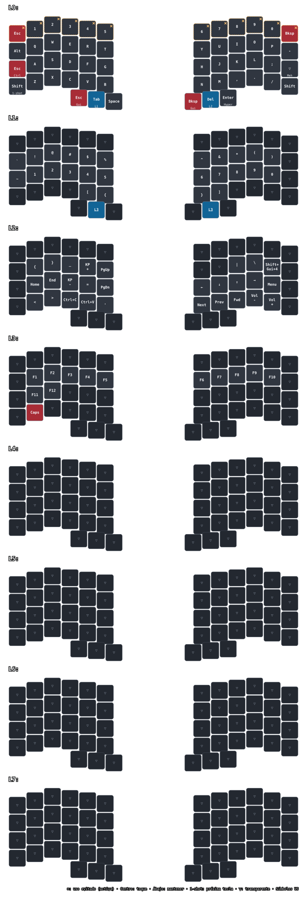

# Silakka54: respaldo y referencia de teclas

**`silakka54_main.vil` es la fuente de verdad y el respaldo de la configuración
exportada desde Vial.** Los scripts solo lo leen: nunca lo modifican ni escriben
en el teclado. Conservá este archivo aunque no necesites el gráfico.



## Flujo: guardar → generar → revisar → commit

1. Ajustá las teclas en Vial y exportá la configuración a `silakka54_main.vil`.
2. Generá el gráfico, manualmente o con el observador de archivos.
3. Abrí **`keymap.svg`** y revisá cada capa contra tu configuración.
4. Recién entonces añadí el `.vil`, `keymap.yaml` y `keymap.svg` a Git y hacé commit.

**El commit no genera imágenes ni añade archivos al stage.** Se eliminó el hook
anterior: la revisión del gráfico tiene que ocurrir antes, no durante el commit.

### Generar una vez

Desde la raíz del repositorio (también funciona desde cualquier otra carpeta
usando la ruta al script):

```bash
./hardware/silakka54/render.sh
```

### Regenerar automáticamente al guardar

```bash
./hardware/silakka54/render.sh --watch
```

Hace una generación inicial y después observa el contenido del `.vil` y de las
fuentes del renderizador. Espera a que termine el guardado antes de regenerar.
Dejá esa terminal abierta mientras ajustás el teclado; `Ctrl+C` detiene el
observador. No instala servicios, no depende de Git y no hace commits.
Si un guardado es inválido, informa el error, conserva el gráfico anterior y
vuelve a intentarlo cuando cambien las fuentes.

## Cómo leer el gráfico

- **L0–L7**: todas las capas exportadas, incluidas las vacías/transparentes.
- **Centro**: acción al tocar y soltar la tecla.
- **Abajo**: en las teclas de doble función, acción al mantenerlas presionadas.
  Por ejemplo, `Tab` con `L1` debajo significa: tocar envía Tab; mantener activa L1.
- **1-shot**: no es una acción que requiera mantener la tecla. Indica que el
  modificador queda preparado para la siguiente pulsación. En el Shift izquierdo,
  tocá y soltá Shift y luego pulsá `a`: obtenés `A` sin sostener Shift. Si lo
  mantenés presionado, también funciona como Shift normal.
- **▽**: tecla transparente; se busca su acción en una capa activa inferior.
  No significa «deshabilitada» ni se reemplaza siempre por la tecla de L0:
  depende de qué capas estén activas. Una tecla sin acción queda en blanco.
- **Azul**: cambio de capa. **Rojo**: Esc, Backspace, Delete o Caps Lock.
- **× y borde discontinuo**: uso evitado por decisión personal; la tecla sigue activa.
- **Meh**: Ctrl+Alt+Shift. **Hyper**: Ctrl+Alt+Shift+Gui.

El gráfico representa las asignaciones por capa, no una simulación del estado
del teclado. No representa combos, macros, tap dances ni tiempos de pulsación;
esos datos se conservan en el `.vil`.

### Decisión personal de ergonomía: evitar la fila superior

No uso intencionalmente la fila superior (Esc, números y Backspace) para limitar
el desplazamiento de los dedos a una posición desde la fila central. Por eso
sus 12 teclas están marcadas con **× solo en L0**. Siguen teniendo sus funciones:
la marca no las desactiva ni cambia el `.vil` o las demás capas. Eventualmente
planeo migrar a un teclado sin esa fila. La anotación se reaplica al generar el gráfico.

### Gui: el mismo modificador en distintos sistemas

**`Gui` es el nombre técnico neutral del modificador**, no una tecla exclusiva
de macOS. En el gráfico se mantiene esa etiqueta corta para no sobrecargar
las teclas con varios nombres:

| Sistema | Nombre habitual de Gui |
|---|---|
| macOS | Cmd / Command (⌘) |
| Linux | Super |
| Windows | Win / Windows |

En tu configuración:

- **Esc / Gui**, pulgar izquierdo: tocar envía Esc; mantener activa Gui izquierdo.
- **Bksp / Gui**, pulgar derecho: tocar envía Backspace; mantener activa Gui derecho.

Ambos son modificadores Gui; la distinción izquierda/derecha se conserva en el
`.vil`. El teclado puede enviar los mismos códigos en todos los sistemas,
pero eso no garantiza que sus atajos completos tengan el mismo efecto:
el sistema operativo y cada aplicación deciden qué hacer con ellos.

### KP + y KP −: códigos de teclado numérico

**KP significa keypad**, teclado numérico. El respaldo asigna `KC_KP_PLUS` y
`KC_KP_MINUS`: por eso el gráfico muestra `KP +` y `KP -`, aunque no exista un
bloque numérico físico en el Silakka54.

Normalmente producen los símbolos `+` y `-`, pero sus códigos son distintos de
los de la zona principal del teclado y pueden distinguirse en los atajos. No
se elimina `KP` para no ocultar esa diferencia; no depende del sistema operativo.

### Símbolos US: distribución de idioma, no sistema operativo

Los símbolos (`{`, `}`, `!`, etc.) se muestran interpretando los códigos según
la distribución estadounidense **US**. Esto no hace al teclado exclusivo de un
sistema: podés usar una distribución US tanto en macOS como en Linux o Windows.

El teclado envía códigos, no caracteres de texto. La distribución configurada
en el sistema los interpreta; con una distribución de idioma diferente, algunos
caracteres pueden no coincidir con los dibujados.

Referencias oficiales: [modificadores y keypad en QMK](https://docs.qmk.fm/keycodes_basic),
[one-shot](https://docs.qmk.fm/one_shot_keys),
[capas transparentes](https://docs.qmk.fm/keymap#layer-precedence-and-transparency) y
[distribuciones de idioma](https://docs.qmk.fm/reference_keymap_extras).

## Instalación

Se necesita Python 3.10 o posterior. Desde la raíz del repositorio:

```bash
cd hardware/silakka54
python3 -m venv .venv
.venv/bin/python -m pip install -r requirements.txt
./render.sh
```

Las versiones probadas de `keymap-drawer` y `PyYAML` están fijadas. La generación
no descarga geometría, iconos ni fuentes: usa `qmk_info.json` y fuentes locales.
`keymap-drawer` puede mostrar un aviso de deprecación de Pydantic al cargar su
configuración; no es un fallo de generación. El script verifica el SVG antes de
publicarlo y devuelve un error si no puede generarlo.

## Archivos

| Archivo | Función |
|---|---|
| `silakka54_main.vil` | Respaldo original; no se regenera ni modifica |
| `render.sh` | Generación segura; solo publica resultados completos y validados |
| `watch.py` | Regeneración automática opt-in al guardar las fuentes |
| `convert_vial.py` | Valida 54 posiciones y normaliza el orden físico y `LTn` |
| `post_process.py` | Traduce leyendas, aplica estilos y anota la fila de uso evitado en L0 |
| `qmk_info.json` | Posiciones físicas, incluyendo el orden de los pulgares |
| `draw_config.yaml` | Estilo del gráfico y leyenda |
| `keymap.yaml`, `keymap.svg` | Artefactos generados; no editar a mano |

## Pruebas

```bash
hardware/silakka54/.venv/bin/python -m unittest discover -s hardware/silakka54 -p 'test_*.py' -v
```

Comprueban el orden de ambas manos y pulgares, traducciones, capas, generación
reproducible, marcas de uso evitado solo en L0, regeneración al guardar y
conservación de salidas ante errores.
